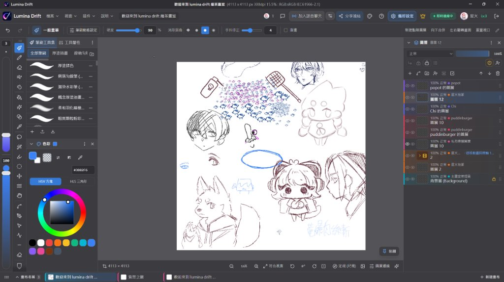

# Lumina Drift Paint

[繁體中文](README.md) · [简体中文](README.zh-CN.md) · **English** · [日本語](README.ja.md)

Lumina Drift Paint is a free, open-source app for professional digital painting and real-time collaborative drawing. Work offline or share a live canvas across devices with pressure-sensitive input, advanced layer controls, brush imports, and plugins.

[Download the latest release](https://github.com/starfireqwq/lumina-drift/releases/latest) · [Changelog](docs/CHANGELOG.md) · [Plugin guide](docs/PLUGINS.md)



## Core features

- **Drawing tools and brush engine.** The toolbar groups subtools into 11 main categories and offers a classic expanded layout. Press the same shortcut repeatedly to cycle through subtools, each with its own saved settings. The five fill tools include Gap Fill Brush, Enclose and Fill, Lasso Fill, and two bucket modes that reference other layers or only the active layer. Use rectangular and elliptical selections, the polygonal lasso, brush stabilization, subtractive OKLab mixing, live filters, and layer masks. The vector eraser clears to an intersection, erases a segment, or removes an entire stroke.
- **Drawing aids and shape editing.** Load multiple references in Sub View and zoom, flip, rotate, or automatically sample colors from them. Pin swatches in color history and import or export `.aco` and `.gpl` palettes. Mix colors on the mini Mixing Pad or pick colors and tools from the desktop Pop-up Palette. QuickShape snaps strokes to clean shapes, Puppet Warp adjusts an image with pins, and Wrap-Around lets you paint across edges for seamless patterns.
- **Non-destructive adjustments, Auto Actions, and typography.** Six live adjustment layers cover HSL, Levels, Curves, Color Balance, Gradient Map, and Brightness/Contrast, with clipping masks, layer and group masks, and group isolation. Record and play back Auto Actions, undo an entire playback in one step, and share actions as `.lumina-action` files. Rich text supports inline styles, wrapping in fixed text boxes, strokes behind fills, shadows, and line-break rules for vertical punctuation. The workspace also includes a 2D animation timeline, comic panels, and speech balloons.
- **Print color management and file compatibility.** Preview CMYK soft proofs and gamut warnings locally with optional custom `.icc` or `.icm` profiles. Embed RGB ICC profiles in PNG, JPEG, and PSD exports. Open and save `.lumina` projects, import and export Krita (`.kra`) and Adobe Photoshop (`.psd`) files, and export OpenRaster (`.ora`), layered PNG ZIP, transparent PNG, or JPEG.
- **Time-lapse, collaboration, and cross-device support.** Replay your drawing at 1×, 4×, 16×, or 64× and export a WebM or MP4 time-lapse. Start a local room from the desktop app and let phones and tablets on the same network join in a browser. Use touch gestures and pressure-sensitive input from devices such as Apple Pencil, Wacom tablets, Surface Pen, and S-Pen. Switch between dark and light themes and choose Traditional Chinese, Simplified Chinese, English, or Japanese.

## Download and install

- **Windows** (Setup installer or Portable build)
- **macOS** (Apple Silicon `arm64` or Intel `x64`)
- **Android** (APK)
- **Web** (ZIP)

Download the build for your device from [GitHub Releases](https://github.com/starfireqwq/lumina-drift/releases/latest).

## Plugins

Open a canvas and choose **Plugins → Manage Plugins…** from the top menu to install and manage `.lumina-plugin` packages. See the [plugin guide](docs/PLUGINS.md).

## Self-hosting with Docker

```bash
docker compose up -d
docker compose logs -f
docker compose down
```

Once the server is running, open `http://localhost:3000` in your browser.

## Privacy and licensing

The [privacy notice](apps/client/installer/LICENSE.txt) explains how the app handles offline artwork and collaboration data.

The source code is available under the [MIT license](LICENSE). See [THIRD_PARTY_NOTICES.txt](apps/client/public/THIRD_PARTY_NOTICES.txt) for third-party licenses. Creators retain the rights to their artwork.
