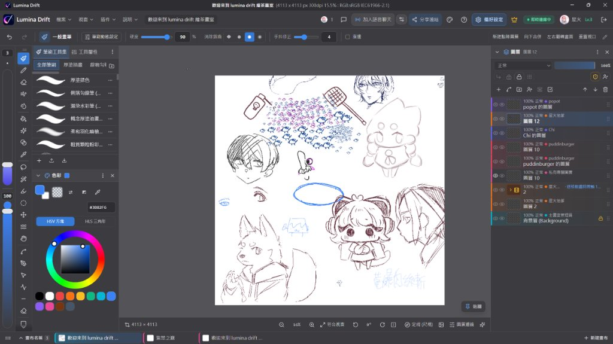

# Lumina Drift Paint

[繁體中文](README.md) · [简体中文](README.zh-CN.md) · [English](README.en.md) · **日本語**

Lumina Drift Paint は、プロ向けのイラスト制作とリアルタイムの共同お絵描きに対応した、無料のオープンソースアプリです。オフラインで作画できるほか、異なる端末から同じキャンバスに描き込めます。ペンの筆圧入力、レイヤー編集、ブラシの読み込み、プラグインに対応しています。

[最新版をダウンロード](https://github.com/starfireqwq/lumina-drift/releases/latest) · [更新履歴](docs/CHANGELOG.md) · [プラグインガイド](docs/PLUGINS.md)



## 主な機能

- **描画ツール・ブラシエンジン・レイヤー管理**。14 のメインツールカテゴリ（独立したテキスト・漫画・アニメーション・5 種消しゴムサブツール群を含む）とサブツールセットは、クラシック展開表示、同一ショートカットでの循環切替、サブツール別設定記憶に対応。塗りつぶしは単一バケツ、スマート塗り（囲って塗る／塗り残し補正を統合）、投げ縄塗りの 3 種に集約し、消しゴムは 4 段階アンチエイリアスに対応します。デュアルブラシ、カラーダイナミクス、水彩ウェットエッジ、減法顔料混色、マルチチップ切替、手ブレ補正、`.sut`／`.brushset` の高度な読み込み、`.abr`（v6.2）書き出しに対応。8 色のレイヤーカラーラベル、非破壊の下書き着色、「用紙」背景色切替、クイックマスク（`Q`）、色域指定選択、3 モードのベクター消しゴム、4K〜8K+ キャンバス向け Tile GPU LRU プールとメモリ保護機構も備えています。
- **定規システム・作画補助パネル・変形ツール**。集中線／放射定規、曲線／ベジェ特殊定規、レイヤー連動定規、純 2D の 1/2/3 点透視空間グリッドを利用できます。フローティングパネルはアイコンボールに折りたたみ、縦横切替可能なカプセル Dock へ磁着統合できます。リアルタイムキャンバスナビゲーター（表示範囲赤枠・上下反転・`Shift`／`Ctrl+Shift` ホイール回転角度カスタマイズ対応）、サブビュー（Sub View）の複数資料表示、色の履歴（`.aco`／`.gpl`）、ミニ混色パレット、ポップアップパレット（Pop-up Palette）、クイックシェイプ（QuickShape）、パペットワープ（Puppet Warp）、ラップアラウンド（Wrap-Around）にも対応します。
- **非破壊補正・レイヤー効果・オートアクション・アニメーション**。6 種のリアルタイム色調補正レイヤー（HSL、レベル、トーンカーブ、カラーバランス、グラデーションマップ、明るさ／コントラスト）と 4 種の非破壊レイヤー効果（フチ／水彩境界、ドロップシャドウ、光彩、カラーオーバーレイ）を、クリッピングやマスクと組み合わせて使えます。1 ステップで取り消せるオートアクション（`.lumina-action`）、ローカルフォントスキャン・検索ピッカー・縦横切替・縦書き禁則対応のリッチテキスト、漫画コマ割り・吹き出しに加え、音声波形表示・ドラッグ同期・MP4／WebM 音声ミックス書き出し対応の 2D アニメーションタイムラインを搭載しています。
- **商業印刷向け色管理とファイル互換性**。ローカルでの CMYK ソフトプルーフと色域外警告（`.icc`／`.icm` 対応）に加え、GCR／UCR 黒版設定とリアルタイム総インキ量（TAC）警告・自動制限を備えた真の 4 チャンネル CMYK Baseline TIFF 6.0 および CMYK PSD 書き出しに対応。`.lumina` の読み書き、Krita（`.kra`）・Photoshop（`.psd`）の入出力、OpenRaster（`.ora`）、レイヤー別 PNG ZIP、WebP、透過 PNG、RGB ICC 埋め込み JPEG 書き出しも利用できます。
- **タイムラプス・共同お絵描き 2.0・クロスデバイス連携**。1〜64 倍速のタイムラプス再生と WebM／MP4 書き出しに対応。デスクトップ版からワンクリックでローカルルームを作成でき、他作家の視点追従（回転・反転・DPI 同期）、コマ割り担当（Grid Slots）、ルーム共有スウォッチ、共有資料ボードを活用して同じネットワークのスマホ・タブレットからブラウザー参加できます。Apple Pencil・Wacom・Surface Pen・S-Pen の筆圧、ダーク／ライトテーマ、6 種の UI サーフェス質感（デュアルストリーム発光のカスタマイズ対応）、繁体字・簡体字・英語・日本語 UI に対応します。

## ダウンロードとインストール

- **Windows**（Setup インストーラー、インストール不要の Portable 版）
- **macOS**（Apple Silicon `arm64`、Intel `x64`）
- **Android**（APK）
- **Web**（ブラウザー版の ZIP）

[GitHub Releases](https://github.com/starfireqwq/lumina-drift/releases/latest) から、お使いの端末に合った版をダウンロードしてください。

## プラグイン

キャンバスを開き、上部メニューの **プラグイン → プラグインの管理…** から `.lumina-plugin` をインストール・管理できます。詳しくは[プラグインガイド](docs/PLUGINS.md)をご覧ください。

## Docker でサーバーを起動する

```bash
docker compose up -d
docker compose logs -f
docker compose down
```

サーバーを起動したら、ブラウザーで `http://localhost:3000` を開いてください。

## プライバシーとライセンス

オフラインで制作した作品や共同作業データの取り扱いは、[プライバシーに関する声明](apps/client/installer/LICENSE.txt)をご覧ください。

ソースコードは [MIT ライセンス](LICENSE)で公開しています。サードパーティー製コンポーネントのライセンスについては [THIRD_PARTY_NOTICES.txt](apps/client/public/THIRD_PARTY_NOTICES.txt) をご覧ください。作品の権利は制作者に帰属します。
