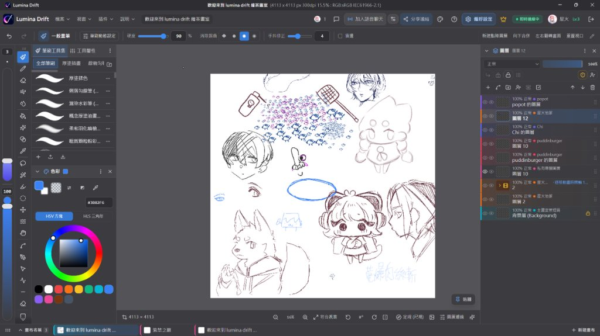

# Lumina Drift Paint

Lumina Drift Paint 是一款開源繪圖軟體。你可以在本機離線作畫，也可以加入多人繪茶，在同一張畫布上同步創作。支援電繪筆壓感、圖層、筆刷匯入，以及 JavaScript 插件。

[下載最新版本](https://github.com/starfireqwq/lumina-drift/releases/latest) · [軟體介紹 PDF](https://github.com/starfireqwq/lumina-drift/releases/download/v1.1.0/Lumina-Drift-Paint-Introduction-zh-TW.pdf)



---

## 核心功能

### 1. 畫布縮時錄影與操作重播引擎 (Time-Lapse Replay)
- **歷史操作平滑回放**：利用伺服器 SQLite `canvas_ops` 單調遞增操作定序日誌與 `canvas_snapshots` 檢查點，從第 0 筆 Op 至最新畫面流暢逐筆重建繪畫過程。
- **多倍速重播控制**：支援 `1x` (原速)、`4x`、`16x`、`64x` 極速快進播放，具備時間軸進度滑塊 (Scrubber) 隨意跳轉至任意操作步數。
- **縮時影片錄影匯出**：基於 HTML5 Canvas `captureStream()` 與 `MediaRecorder`，一鍵即時渲染並匯出 **WebM (VP9 4K支援)** 或 **MP4 (AVC 相容)** 繪圖過程短影片供社群分享。

### 2. 多圖層檔案匯出與跨軟體相容性 (Export & Formats)
- **標準 Adobe Photoshop (.psd)**：基於 `ag-psd` 純原生產生具備 `8BPS` 標準標頭之 PSD 檔案，完整保留各圖層名稱、不透明度、混合模式（正常、色彩增值、濾色、覆蓋等）與圖層顯示隱藏狀態，相容 Photoshop、CSP、SAI。
- **OpenRaster (.ora) 開放標準多圖層封裝**：Krita、MyPaint、GIMP 與 CSP 原生支援的開源多圖層打包標準，內含標準 `stack.xml` 圖層樹描述與各圖層無損 PNG。
- **多圖層 PNG 打包 (.zip)**：將每一圖層個別儲存為獨立 PNG 檔案，並自動產生 `layers_manifest.json` 元資料封裝成 ZIP。
- **單張合併影像 PNG**：支援含畫布底色（白色/自訂背景）或**透明背景 (Transparent PNG)** 匯出。

### 3. 本地端一鍵伺服器與跨裝置連線 (Local Atelier Server)
- **Electron 桌面端一鍵啟動**：在軟體內點擊「本地開房」即可直接啟動後端 Node.js + Fastify + WebSocket + SQLite (WAL) 伺服器，自動監聽 `0.0.0.0:3000`。
- **跨裝置支援（手機 / 平板 / 電腦）**：
  - 同一 Wi-Fi 區域網路內，iPad（Safari）、Android 平板（Chrome）或手機無須安裝任何客戶端，直接開啟區域網路網址（如 `http://192.168.x.x:3000`）即可進房連線。
  - 專屬行動裝置觸控最佳化：防止手勢誤縮放與頁面滾動 (`touch-action: none`)、自適應懸浮工具箱與抽屜式圖層面板。
- **電繪筆高頻壓感支援 (Stylus Pressure Sensitivity)**：
  - 完整支援 Chromium `PointerEvent.getCoalescedEvents()` 採樣，相容 Apple Pencil、Wacom、Surface Pen、三星 S-Pen 與各式數位板。
  - 設定面板內建「電繪筆壓感即時測試與校準區」，可視覺化檢視目前採樣壓感數值與動態筆刷大小。

### 4. 介面視覺與多語系支援 (Theme & Multilingual i18n)
- **深色 / 淺色主題動態絲滑切換**：
  - 專業深色繪圖主題 (Dark Mode)：低眼疲勞、色彩沉浸。
  - 明亮高對比主題 (Light Mode)：清晰通透。
  - 具備 CSS 平滑過渡動效 (`theme-transition`)，點擊頂部導航列太陽/月亮圖示即時切換。
- **四國語言動態切換 (i18n)**：
  - 繁體中文 (`zh-TW`)
  - 簡體中文 (`zh-CN`)
  - 英文 (`en-US`)
  - 日文 (`ja-JP`)
  - 可於頂部導航列快速切換或至偏好設定選擇，全介面即時生效並持久化儲存於 `localStorage`。

### 5. 進階筆刷、混色與 WebGL2 濾鏡
- **動態重心手抖修正 (Stabilizer)**：慢速平滑刻線、快速運筆無延遲感。
- **OKLab 減色逼真混色**：黃色 + 藍色 = 翠綠色，杜絕傳統灰泥漿感；支援水分與混色衰減。
- **專業選區系統**：自由套索 (Lasso)、魔術棒 (Magic Wand)、擴張/縮張 (+3px/-3px)、動態雙色螞蟻線限制。
- **GPU 濾鏡特效 (FBO Ping-Pong)**：雙通高斯模糊 (Dual Blur)、45° 漫畫網點 (Halftone)、色差分離 (RGB Split)、漩渦扭曲 (Twirl)、紙質雜訊 (Noise & Grain)、色彩反相 (Invert)。

---

## 桌面端安裝與一鍵打包 (Electron Builder)

專案已完整設定 `electron-builder`，支援 Windows、macOS 與 Linux 原生發布包：

```bash
# 1. 編譯前端與桌面端主進程
pnpm --filter @atelier/shared build
pnpm --filter @atelier/client build:electron

# 2. 產生 Windows 免安裝便攜版 / 綠色目錄 (release/win-unpacked/AtelierSync.exe)
pnpm --filter @atelier/client pack:electron

# 3. 產生 Windows 原生 NSIS 安裝包 (.exe) 與 Portable 單一執行檔
pnpm --filter @atelier/client dist:win

# 4. 在 macOS 產生安裝套件 (.pkg)
pnpm --filter @atelier/client dist:mac

# 5. 產生 Linux 原生 AppImage 與 tar.gz
pnpm --filter @atelier/client dist:linux
```

Windows 封裝時，可先依 [Windows 縮圖擴充指引](apps/client/native/lumina-thumb-provider/README.md)編譯縮圖元件，並從 [Cloudflare 官方下載頁](https://developers.cloudflare.com/cloudflare-one/connections/connect-networks/downloads/)取得 Windows x64 的 `cloudflared.exe`，放到 `apps/client/resources/`。桌面 App 也能使用已加入系統 PATH 的 `cloudflared`。

### 安裝與隱私權聲明

Windows 安裝程式的授權頁包含[隱私權聲明](apps/client/installer/LICENSE.txt)，說明離線作品的儲存方式、房主伺服器如何接收協作資料，以及啟用 Cloudflare Quick Tunnel 時流量如何轉送。免安裝版也適用同一份聲明。[Cloudflare 隱私權政策](https://www.cloudflare.com/privacypolicy/) · [Quick Tunnels 說明](https://developers.cloudflare.com/tunnel/get-started/quick-tunnels/)

## 插件開發

開啟畫布後，在上方選單選擇 **插件 → 管理插件**。可以從這裡下載範例、匯入 `.lumina-plugin` 檔案，確認權限再啟用。啟用後，插件的指令會出現在同一個選單中。

插件可用 JavaScript 開發。請參閱[插件 API v1](docs/PLUGINS.md)。

---

## 私域自架與啟動方式 (Web & Docker)

### 方式一：本機一鍵開發與啟動

```bash
# 安裝所有相依套件
pnpm install

# 編譯所有模組
pnpm build

# 執行全套自動化端對端驗證測試 (Phase 1 ~ Phase 5)
pnpm test

# 啟動整合後端伺服器 (包含前端靜態資源託管)
pnpm dev:server
```

### 方式二：Docker Compose 容器部署 (NAS / VPS)

```bash
# 1. 啟動服務 (自動編譯前後端並掛載 ./data 本地目錄)
docker compose up -d

# 2. 查看運行日誌
docker compose logs -f

# 3. 停止服務
docker compose down
```

瀏覽器打開 `http://localhost:3000` 或區網 IP `http://<您的IP>:3000` 即可跨裝置開始繪茶！

首次建立資料庫時，管理員帳號預設為 `admin`。可在啟動前設定 `ADMIN_PASSWORD`，或到伺服器資料目錄的 `initial-admin-password` 讀取自動產生的密碼。登入並改密碼後，可以移除這個檔案。資料目錄預設為 `apps/server/data`，Docker Compose 對應專案根目錄的 `data`。如有自行管理登入簽章金鑰的需求，可設定 `JWT_SECRET`；未設定時，會在資料目錄產生並保留每台伺服器自己的金鑰。

---

## 內網穿透提示（免設定路由器 Port Forwarding）

1. **Tailscale（強烈推薦）**：所有人安裝 Tailscale 登入同一虛擬網段，將 `http://100.x.y.z:3000` 分享給好友，端對端 WireGuard 加密、零配置。
2. **Cloudflare Tunnel (`cloudflared`)**：本機執行 `cloudflared tunnel --url http://localhost:3000`，立即獲得專屬安全 HTTPS 公開網址，好友手機/平板點開即畫！

## 授權

Lumina Drift Paint 原始碼依 [MIT 授權](LICENSE)提供。內含元件依[各自的授權聲明](apps/client/public/THIRD_PARTY_NOTICES.txt)散布。使用者創作的畫作依創作者自己的授權管理。
