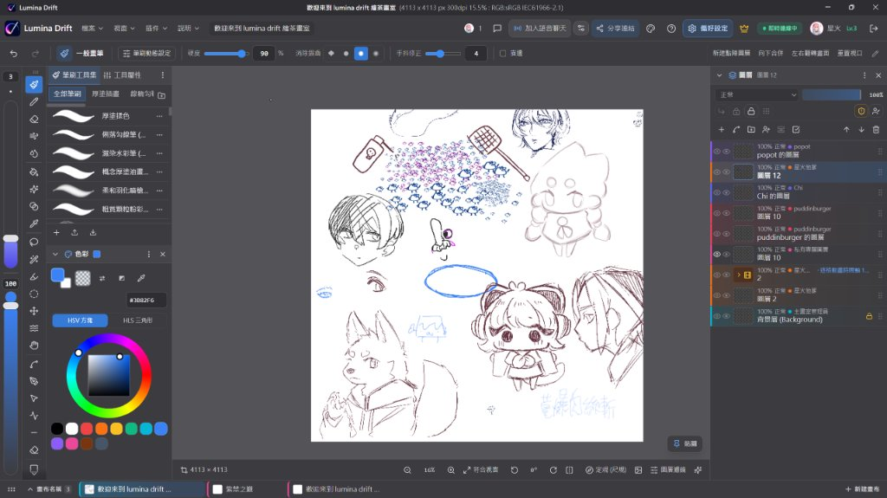

# Lumina Drift Paint

[繁體中文](README.md) · **简体中文** · [English](README.en.md) · [日本語](README.ja.md)

Lumina Drift Paint 是一款免费开源的专业绘画与多人实时共绘软件。你可以离线绘画，也可以跨设备在同一张画布上同步创作。软件支持数位笔压感、高级图层、笔刷导入和插件。

[下载最新版本](https://github.com/starfireqwq/lumina-drift/releases/latest) · [版本更新记录](docs/CHANGELOG.md) · [插件说明](docs/PLUGINS.md)



## 核心功能

- **专业工具组与绘画引擎**。11 个主工具分类及辅助工具组支持经典展开模式，可重复按快捷键循环切换，并记住各子工具的设置。5 种填充工具包括间隙填充笔、包围涂抹、套索涂抹，以及参考其他图层和仅参考编辑图层的油漆桶。支持矩形和椭圆选框、多边形套索、笔刷抖动修正、OKLab 减色混色、实时滤镜与图层蒙版。矢量橡皮擦可擦至交点、局部擦除或删除整条笔画。
- **绘画辅助面板和变形工具**。子视图（Sub View）可加载多张参考图，支持缩放、翻转、旋转和自动吸色。颜色历史可固定色板并导入或导出 `.aco` 和 `.gpl`，另有迷你混色盘和桌面弹出调色盘（Pop-up Palette）。快速形状（QuickShape）可将笔画吸附为规整图形，操控变形（Puppet Warp）可用图钉调整图像，四方连续平铺（Wrap-Around）可跨边界绘制无缝图案。
- **非破坏性调整、自动动作与排版**。6 种实时调整图层涵盖 HSL、色阶、色调曲线、色彩平衡、渐变映射和亮度／对比度，支持剪贴蒙版、图层与组蒙版及组隔离。自动动作（Auto Actions）可录制和播放，整段播放可一步撤销，也可通过 `.lumina-action` 分享。富文本支持局部样式、固定文本框自动换行、描边置于填充之后、阴影和竖排标点避头尾。另有 2D 动画时间轴、漫画分格和对话气泡。
- **印刷色彩管理与文件互通**。在本地预览 CMYK 软打样和超色域警告，可导入自定义 `.icc` 或 `.icm` 配置文件。导出 PNG、JPEG 或 PSD 时可嵌入 RGB ICC 配置文件。支持读写 `.lumina` 项目、导入和导出 Krita（`.kra`）及 Adobe Photoshop（`.psd`），并可导出 OpenRaster（`.ora`）、多图层 PNG ZIP、透明 PNG 或 JPEG。
- **延时回放、多人共绘与跨设备支持**。可用 1×、4×、16× 或 64× 回放绘画过程，并导出 WebM 或 MP4 延时视频。桌面版可一键在本地开房，让同一局域网内的手机和平板通过浏览器加入。支持触控手势，以及 Apple Pencil、Wacom 数位板、Surface Pen 和 S-Pen 等设备的压感输入。界面可切换深色与浅色主题，提供繁体中文、简体中文、英语和日语。

## 下载与安装

- **Windows**（安装版 Setup、免安装便携版 Portable）
- **macOS**（Apple Silicon `arm64`、Intel `x64`）
- **Android**（APK）
- **Web**（网页版 ZIP）

请前往 [GitHub Releases](https://github.com/starfireqwq/lumina-drift/releases/latest) 下载适合你设备的版本。

## 插件支持

打开画布后，在顶部菜单选择 **插件 → 管理插件…**，即可安装和管理 `.lumina-plugin` 插件。请参阅[插件说明](docs/PLUGINS.md)。

## 自建服务器与 Docker 快速启动

```bash
docker compose up -d
docker compose logs -f
docker compose down
```

启动后，在浏览器打开 `http://localhost:3000`。

## 隐私声明与许可证

[隐私声明](apps/client/installer/LICENSE.txt)介绍如何处理离线作品和协作数据。

源代码采用 [MIT 许可证](LICENSE)。第三方组件的许可证请参阅 [THIRD_PARTY_NOTICES.txt](apps/client/public/THIRD_PARTY_NOTICES.txt)。用户作品的权利归创作者所有。
